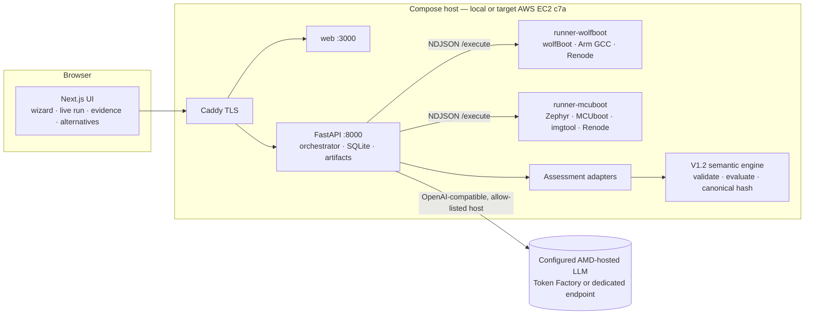

# ReleaseProof — Architecture

## Responsibilities

| Component | Does | Never does |
|---|---|---|
| Runners | Build, sign, emulate (Renode), parse UART/artifacts, emit typed **observations** with artifact hashes | Decide verdicts; run arbitrary commands (allow-listed templates only); reach the internet |
| Adapters | Project observations into a V1.2 assessment (states, plan, evidence, gaps) | Invent facts: missing observation ⇒ `UNKNOWN`/gap |
| Engine (`core/`) | Deterministic verdicts (candidate / transition / migration), explanation graph, canonical hash | Change without golden-hash regression |
| AI gateway (AMD) | Test planning within the catalog, cited explanations, alternative plans from an allowed set, grounded chat | Produce verdicts, measurements or shell commands; fall back to non-AMD providers |
| Orchestrator | State machine, queue, persistence, SSE, manifests, re-evaluation runs | Fall back to recorded data when a runner fails |

## Run lifecycle

`PREPARING → AI_PLAN → DISCOVERY → BUILD_SIGN → EMULATION_TESTS → EVALUATION → NEXT_STEPS`

- **AI_PLAN**: the AMD-hosted model orders/selects optional templates; required templates are
  enforced by policy; unknown templates are blocked and shown.
- **Runner**: one isolated workspace per run, pinned sources baked in the image, ephemeral keys,
  Renode virtual time, UART captured to file, every artifact hashed.
- **EVALUATION**: adapter → `evaluate()` → gap plan → dossier → `manifest.json` (inputs, pins,
  artifact hashes, result hash).
- **NEXT_STEPS**: cited explanation + alternative plans (PROPOSAL). Choosing an alternative creates a
  **new** run (`REEVALUATION` on the parent's evidence, or `LIVE` when new tests are needed). History
  is never mutated.

## Trust boundaries

- LLM output is untrusted: JSON-schema validation, allow-lists, citation checks, verdict echo check.
- Tool output (logs/UART) passed to the LLM is wrapped as untrusted data (prompt-injection defense).
- Runner network is `internal`; secrets only in the API container.
- The endpoint allow-list is an operator configuration, not GPU attestation. The managed
  Token Factory smoke records an undisclosed GPU; MI300X is a separate self-hosted option.
- The current API has no authentication/authorization or tenant boundary. An authenticated
  gateway is required for an untrusted/public deployment; Caddy TLS does not supply that boundary.
- Run one API process/worker per data volume. Runner slot coordination and restart recovery are
  process-local; multiple uvicorn workers or API replicas are not supported on the same SQLite store.
- Graceful shutdown drains active runner/AI operations before closing SQLite. It can take as long
  as those operations; a forced container/process kill interrupts the run. Restart recovery marks
  interrupted work failed, never successful or replayed from reference data.
- Artifact paths are confined to their owner's run directory, and downloads verify size/hash.
  Invalid runner IDs/paths fail the protocol; changed artifacts return HTTP 409. The shared volume
  must be trusted: verification and file serving are not an atomic snapshot against hostile writers.
- The AI gateway rejects credential-bearing/query/fragment endpoint URLs, malformed responses,
  and streams lacking the terminal OpenAI-compatible `[DONE]` marker. SSE cursors must fit a
  non-negative signed 64-bit SQLite integer; invalid `after` query values return HTTP 422.
- Recorded acceptance reports verify local runs, not cloud deployment status. See
  [`CODE_AUDIT.md`](CODE_AUDIT.md) for offline verification and remaining limitations.
