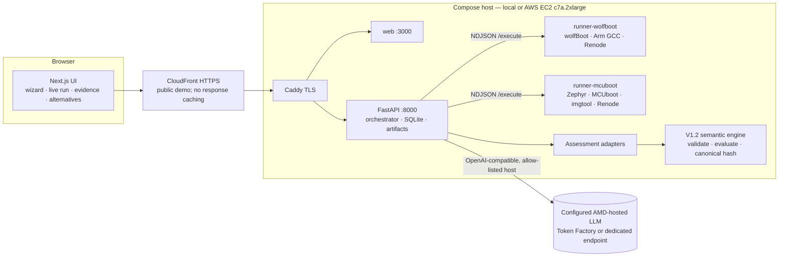

# ReleaseProof — Architecture

## Responsibilities

| Component | Does | Never does |
|---|---|---|
| Runners | Build, sign, emulate (Renode), parse UART/artifacts, emit typed **observations** with artifact hashes | Decide verdicts; run arbitrary commands (allow-listed templates only); reach the internet |
| Adapters | Project observations into a V1.2 assessment (states, plan, evidence, gaps) | Invent facts: missing observation ⇒ `UNKNOWN`/gap |
| Engine (`core/`) | Deterministic verdicts (candidate / transition / migration), explanation graph, canonical hash | Change without golden-hash regression |
| AI gateway (AMD) | Test planning within the catalog, cited explanations, alternative plans from an allowed set, grounded chat | Produce verdicts, measurements or shell commands; fall back to non-AMD providers |
| Orchestrator | State machine, queue, persistence, SSE, manifests, re-evaluation runs | Fall back to recorded data when a runner fails |

## Run lifecycle

`PREPARING → AI_PLAN → DISCOVERY → BUILD_SIGN → EMULATION_TESTS → EVALUATION → NEXT_STEPS`

- **AI_PLAN**: the AMD-hosted model orders/selects optional templates; required templates are
  enforced by policy; unknown templates are blocked and shown.
- **Runner**: one isolated workspace per run, pinned sources baked in the image, ephemeral keys,
  Renode virtual time, UART captured to file, every artifact hashed.
- **EVALUATION**: adapter → `evaluate()` → gap plan → dossier → `manifest.json` (inputs, pins,
  artifact hashes, result hash).
- **NEXT_STEPS**: cited explanation + alternative plans (PROPOSAL). Choosing an alternative creates a
  **new** run (`REEVALUATION` on the parent's evidence, or `LIVE` when new tests are needed). History
  is never mutated.

## Trust boundaries

These controls are deployed on the public demo; see [`EVIDENCE.md`](EVIDENCE.md) §2 for the
container inspection collected from the running host.

### AI boundary

- **LLM output is untrusted.** It passes JSON-schema validation, template allow-lists, a check
  that every cited evidence ID exists, and an exact echo of the engine verdicts.
- **Tool output is wrapped as untrusted data** before it reaches the LLM (logs and UART
  captures), as a defence against prompt injection.
- **Assistant text is held back until checked.** It is buffered until the upstream stream
  completes, then citation IDs and phase-specific verdict labels are validated before anything
  is shown. This is not a formal proof of natural-language entailment; engineering review
  remains part of the workflow.
- **Endpoint restrictions.** The AI gateway rejects endpoint URLs that carry credentials, a
  query or a fragment. It also rejects malformed responses and streams without the terminal
  `[DONE]` marker.
- **The allow-list is configuration, not attestation.** The endpoint allow-list is operator
  configuration; it does not attest which GPU serves the model. AMD Token Factory does not
  disclose its GPU. MI300X is a separate self-hosted option.

### Execution boundary

- **Runners are isolated and unprivileged.** They sit on an `internal` Docker network with no
  internet route, and API secrets stay in the API container only. They run as UID 10001 with all
  capabilities dropped and mount only the `runs/` volume subpath, never SQLite.
- **Runners share one trusted artifact namespace.** That suits pinned open-source fixtures; it
  is not a sandbox for hostile uploaded firmware.
- **Artifact paths are confined to their owner run's directory.** Downloads verify size and
  hash, and a changed artifact returns HTTP 409.
- **Manifests record implementation identity.** Each one holds LF-normalized source
  fingerprints for the backend, engine, adapters and runner code. The acceptance gate compares
  them with the repository.

### Public access

- **The demo is deliberately anonymous.** Viewers need no account, token or password. HTTPS is
  enforced, and the API bounds concurrent jobs (`RELEASEPROOF_MAX_ACTIVE_RUNS`) and POST rate
  (`RELEASEPROOF_MUTATION_RPM`). Only pinned open-source fixtures can be assessed.
- **CloudFront is a pass-through.** It serves `https://d1yxcnwgdgjzt6.cloudfront.net` and
  connects to Caddy over validated HTTPS. It forwards viewer headers except Host and has caching
  disabled for the UI, API and SSE.
- **The origin accepts HTTPS only from CloudFront.** It uses AWS's origin-facing prefix list.
  HTTP/80 stays open for ACME renewal, and SSH is limited to the operator address.

### Operations

- **One API process per data volume.** Runner slot coordination and restart recovery are
  process-local.
- **Graceful shutdown drains active work** before closing SQLite. Restart recovery marks
  interrupted runs `FAILED`; they are never marked successful or replayed from reference data.
