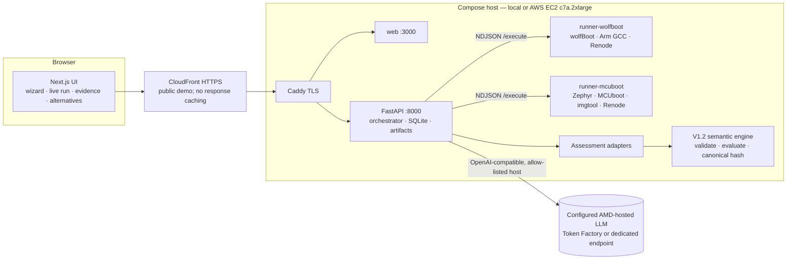

# ReleaseProof — Architecture

## Responsibilities

| Component | Does | Never does |
|---|---|---|
| Runners | Build, sign, emulate (Renode), parse UART/artifacts, emit typed **observations** with artifact hashes | Decide verdicts; run arbitrary commands (allow-listed templates only); reach the internet |
| Adapters | Project observations into a V1.2 assessment (states, plan, evidence, gaps) | Invent facts: missing observation ⇒ `UNKNOWN`/gap |
| Engine (`core/`) | Deterministic verdicts (candidate / transition / migration), explanation graph, canonical hash | Change without golden-hash regression |
| AI gateway (AMD) | Test planning within the catalog, cited explanations, alternative plans from an allowed set, grounded chat | Produce verdicts, measurements or shell commands; fall back to non-AMD providers |
| Orchestrator | State machine, queue, persistence, SSE, manifests, re-evaluation runs | Fall back to recorded data when a runner fails |

## Run lifecycle

`PREPARING → AI_PLAN → DISCOVERY → BUILD_SIGN → EMULATION_TESTS → EVALUATION → NEXT_STEPS`

- **AI_PLAN**: the AMD-hosted model orders/selects optional templates; required templates are
  enforced by policy; unknown templates are blocked and shown.
- **Runner**: one isolated workspace per run, pinned sources baked in the image, ephemeral keys,
  Renode virtual time, UART captured to file, every artifact hashed.
- **EVALUATION**: adapter → `evaluate()` → gap plan → dossier → `manifest.json` (inputs, pins,
  artifact hashes, result hash).
- **NEXT_STEPS**: cited explanation + alternative plans (PROPOSAL). Choosing an alternative creates a
  **new** run (`REEVALUATION` on the parent's evidence, or `LIVE` when new tests are needed). History
  is never mutated.

## Trust boundaries

The bullets below describe the hardened repository configuration. The existing AWS demo
still runs older images: it is anonymous, lacks the new API quotas and has root runners
mounting the full data volume. See the independently checked
[`INFRA_AUDIT_2026-10-17.md`](INFRA_AUDIT_2026-10-17.md) for deployed controls and outstanding drift.

- LLM output is untrusted: JSON-schema validation, allow-lists, citation checks, verdict echo check.
- Tool output (logs/UART) passed to the LLM is wrapped as untrusted data (prompt-injection defense).
- Runner network is `internal`; secrets only in the API container.
- The endpoint allow-list is an operator configuration, not GPU attestation. The managed
  Token Factory smoke records an undisclosed GPU; MI300X is a separate self-hosted option.
- The owner requires anonymous public judging: the UI/API have no login or password gate.
  HTTPS, active-job and POST request limits remain enabled. There is no customer/tenant boundary:
  only pinned open fixtures are accepted. Anonymous access is intentional, not customer authorization.
- The final target is AWS only, behind CloudFront; the abandoned Azure scaffolding was removed.
  Judges need no token, password or cloud account.
- Runners run as UID 10001 with all capabilities dropped. They mount only the `runs/` volume
  subpath, never SQLite. They still share a trusted artifact namespace; this is not a hostile
  multi-tenant sandbox or a general uploaded-firmware service.
- New manifests record LF-normalized source fingerprints for backend, core, adapters and runner
  code/assets. Historical results keep their original hashes and implementation limitations.
- Assistant text is buffered through upstream completion and validated for citation IDs and
  phase-specific verdict labels before any generated text is shown. This is not a formal proof
  of natural-language entailment; human engineering review remains necessary.
- Run one API process/worker per data volume. Runner slot coordination and restart recovery are
  process-local; multiple uvicorn workers or API replicas are not supported on the same SQLite store.
- Graceful shutdown drains active runner/AI operations before closing SQLite. It can take as long
  as those operations; a forced container/process kill interrupts the run. Restart recovery marks
  interrupted work failed, never successful or replayed from reference data.
- Artifact paths are confined to their owner's run directory, and downloads verify size/hash.
  Invalid runner IDs/paths fail the protocol; changed artifacts return HTTP 409. The shared volume
  must be trusted: verification and file serving are not an atomic snapshot against hostile writers.
- The AI gateway rejects credential-bearing/query/fragment endpoint URLs, malformed responses,
  and streams lacking the terminal OpenAI-compatible `[DONE]` marker. SSE cursors must fit a
  non-negative signed 64-bit SQLite integer; invalid `after` query values return HTTP 422.
- The public viewer URL is `https://d1yxcnwgdgjzt6.cloudfront.net`. CloudFront connects to
  Caddy over HTTPS using the origin Host/SNI; it forwards viewer headers except Host and
  disables caching for API results, SSE and UI. Local development bypasses CloudFront.
- Origin HTTPS ingress uses AWS's CloudFront origin-facing prefix list; HTTP/80 remains for
  ACME HTTP-01, and SSH remains operator-only. Shared prefix-list admission is not viewer
  authentication or a per-distribution origin secret.
- Local acceptance alone does not establish cloud deployment/source identity. See
  [`CODE_AUDIT.md`](CODE_AUDIT.md) for historical offline verification and the separate
  [`INFRA_AUDIT_2026-10-17.md`](INFRA_AUDIT_2026-10-17.md) for actual cloud/transport checks.
