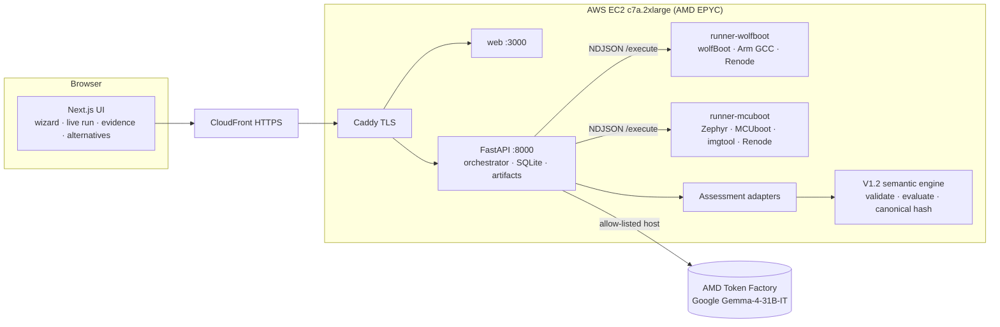

# ReleaseProof: project summary

AMD Developer Hackathon ACT III · lablab.ai · track **Intelligent Industry**

## Title

**ReleaseProof: Firmware Migration Assurance**

## Track

**Intelligent Industry**

## Short description

> ReleaseProof tells industrial IoT teams whether devices already in the field can accept new
> post-quantum firmware, before rollout. Real builds, Renode emulation, deterministic verdicts;
> Google Gemma on AMD plans and explains.

## Long description

Industrial sensor OEMs must keep installed devices updatable for years. Migrating firmware
signatures to post-quantum ML-DSA can produce an image that boots perfectly, yet is rejected by
the bootloader already in the field. The result is a stranded fleet or costly site visits.

ReleaseProof verifies the migration path before rollout. An engineer picks a pinned
device/bootloader profile and a change. Google Gemma on AMD Token Factory plans the verification
from a registered test catalog; required tests cannot be dropped. Isolated runners on an AMD EPYC
host build the real bootloader and images, sign them with ephemeral keys, and boot and update them
in Renode, including tampered-image, wrong-key and cross-generation tests. Every artifact is
SHA-256 hashed. A deterministic engine, never the LLM, issues separate candidate, transition and
migration verdicts. Gemma then explains the result citing evidence IDs and proposes alternatives;
evaluating one creates a new, linked run.

Measured on the public demo with nRF52840 + wolfBoot: the ML-DSA-87 candidate is COMPATIBLE but
the transition is INCOMPATIBLE. It was found in 127 s with 7/7 tests and 57 hashed artifacts. With
MCUboot/Zephyr, the pinned imgtool refuses ML-DSA (6/6 tests, 45 artifacts). Both runs pass a
27-gate acceptance check, including deployed-source identity and validated AMD planning and
reporting.

Each result ships with a portable evidence pack and a CI release gate that blocks unless every
verdict is COMPATIBLE. Interrupted-update recovery is not emulated, so it stays UNKNOWN and nothing
passes without evidence. ReleaseProof sits between inventory scanners and OTA platforms and answers
one question: can the deployed fleet actually get there?

## Who it is for

- **First segment:** OEMs of wireless condition-monitoring sensors in factories and remote sites.
- **Buyer:** Head of Embedded Engineering, Firmware Lead or Product Security Manager, with
  OT/operations as co-sponsor.
- **Operational goal:** keep installed sensors maintainable without avoidable physical
  intervention or gaps in monitoring.

Nordic documents the nRF52840 in industrial products: NI MON-10411, Lynxemi and Atomation. That
establishes hardware relevance only. It does not imply support for proprietary firmware or a
customer relationship.

## Value

**Measured:** a migration blocker that a boot-only check would pass is found in 127 s, in
emulation, before any device is touched. The time includes AMD planning and explanation.

**Illustrative exposure (not measured ROI):** 5,000 sensors × 5% needing a site visit × €250 per
intervention = €62,500 for one blocked rollout. Pilots would measure:

- blockers found before rollout;
- engineering hours saved;
- interventions avoided;
- cost per profile and per run.

**Proposed packaging:** custom-profile onboarding, then a subscription per supported product
profile and assessment volume.

**Positioning:** inventory scanners (Binarly, ONEKEY, Finite State) find what must change; OTA
platforms (Memfault, Mender, Foundries.io) deliver it. ReleaseProof checks the transition from
the deployed bootloader to the candidate, with separate verdicts.

**Regulatory context:**

- **EU Cyber Resilience Act:** reporting obligations from 11 Sep 2026, main obligations from
  11 Dec 2027.
- **CNSA 2.0:** sets quantum-resistant signing timelines for US national security systems.
- **NIST IR 8547:** an initial public draft on deprecating quantum-vulnerable algorithms.

## Tags

`post-quantum cryptography` · `ML-DSA` · `firmware` · `secure boot` · `embedded` · `industrial IoT` ·
`condition monitoring` · `wolfBoot` · `MCUboot` · `Zephyr` · `Renode` · `agentic AI` · `Gemma` ·
`AMD Token Factory` · `AMD EPYC` · `FastAPI` · `Next.js`

## Tech stack

| Layer | Technology |
|---|---|
| UI | Next.js (React), Tailwind, Server-Sent Events for live progress |
| API / orchestration | Python 3.12, FastAPI, SQLite, state-machine orchestrator with queue and per-runner semaphore |
| Runners (Docker, internal network, no egress) | **runner-wolfboot**: wolfBoot `4c79eee`, wolfSSL `4aa1ad7`, Arm GNU Toolchain 14.2.rel1, Renode 1.16.1 · **runner-mcuboot**: Zephyr v4.2.0 sysbuild, MCUboot `4eba8087`, imgtool 2.2.0, Zephyr SDK 0.17.4, Renode 1.16.1 + ReleaseProof NVMC flash model (MIT) |
| Decision engine | ReleaseProof V1.2 semantic engine (validate · evaluate · explanation graph · canonical hash), golden-hash regression tests |
| AI gateway | OpenAI-compatible client, AMD host allow-list, JSON mode with local schema validation, citation and verdict-echo guardrails, per-run traces |
| AMD | Google `Gemma-4-31B-IT` on AMD Token Factory (all four AI modules) · AWS EC2 `c7a.2xlarge`, 4th-gen AMD EPYC, for builds and emulation |
| Edge / deploy | Docker Compose, Caddy (TLS), AWS CloudFront |

## How we use AMD

- **AI on AMD Token Factory.** Every AI step goes to Google Gemma (`Gemma-4-31B-IT`) on AMD
  Token Factory: test planning, cited explanations, alternative plans and the "Ask about this
  run" assistant.
- **One allow-listed endpoint, no fallback.** If the endpoint is unavailable, the steps are
  recorded as `AI_UNAVAILABLE` and the deterministic pipeline still produces the same verdict.
- **Every call is traced** with run, model, host, request ID, latency, tokens and status. Traces
  are visible per run and on `/amd`.
- **Retained results.** The Gemma smoke has 10/10 logical calls OK. The strict live acceptance
  validates AMD planning, explanation and alternatives for both profiles.
- **Compute on AMD EPYC.** The heavy work runs on AWS EC2 `c7a.2xlarge` (4th-gen AMD EPYC):
  cross-compiling bootloaders, signing images and running the Renode emulations for every
  assessment.

Evidence: [`docs/EVIDENCE.md`](../docs/EVIDENCE.md).

## Architecture



Run lifecycle: `PREPARING → AI_PLAN → DISCOVERY → BUILD_SIGN → EMULATION_TESTS → EVALUATION → NEXT_STEPS`.
Runners **measure**, adapters **project** (a missing observation becomes `UNKNOWN`), the engine
**decides**, and the LLM **proposes and explains**.

## Setup

```bash
git clone https://github.com/francescocarpineti091299/release-proof && cd release-proof
cp .env.example .env            # set AMD_LLM_API_KEY (Token Factory + Gemma preconfigured)
docker compose -f docker-compose.yml -f docker-compose.dev.yml up -d --build   # http://localhost:8080
python scripts/acceptance.py --base http://localhost:8080 --require-ai --env-file .env
```

The runner images are about 3.4 GB (wolfBoot) and 3.8 GB (MCUboot). All sources are fetched at
pinned commits when the images are built, and a job needs no network.

## What's real and what's next

| Real today (verifiable in the repo and on the demo) | Next |
|---|---|
| Two LIVE configurations on nRF52840 in Renode 1.16.1, both passing the strict 27-gate acceptance on the public demo (`docs/acceptance/20261017T154930Z.json`) | Hardware-in-the-loop runner on real dev kits |
| Real builds, ephemeral keys, Renode boot and update, positive and negative tests, SHA-256 for every artifact, manifest and canonical hash | Interrupted-update / power-fail test (E12), currently `UNKNOWN` |
| Deterministic V1.2 engine; 422 backend and 96 runner/script tests | Staged hybrid ECDSA + ML-DSA plan (the dual-signature build fails on the pinned wolfBoot commit, as measured) |
| Re-evaluation runs linked to their parent; immutable history; HTTP 422 for alternatives that need external validation | LMS / hash-based signatures for MCUboot (upstream PR #2707 in review) |
| Failed-run policy: runner killed ⇒ FAILED, no verdict, `/result` returns 409 | More boards (STM32, NXP), more bootloader families, key-rotation rulesets |
| AI gateway with schema/citation/verdict guardrails, AMD host allow-list, no fallback | Larger AMD benchmark sample |
| Evidence pack download; strict preflight CLI and GitHub Action (`docs/RELEASE_GATE.md`) | Integration with OTA pipelines |

## Evaluation

### One technical result

On the wolfBoot configuration, ReleaseProof found a migration blocker in **127 s** that a
boot-only check would pass. The ML-DSA-87 candidate boots, yet deployed devices cannot reach it:
there is no bootloader self-update on this nRF52840 port, and the deployed ECDSA bootloader
rejects the ML-DSA update. The verdict comes with **7/7 tests and 57 SHA-256-verified artifacts**
(LIVE run `RP-20261017T154715Z-87d365`, Gemma on AMD). The MCUboot run
`RP-20261017T154354Z-092e99` took 190 s, with 6/6 tests and 45 artifacts.

### One known limitation

This is **emulation, not silicon**. Renode models nRF52840 flash as plain memory for wolfBoot, and
the MCUboot NVMC model is minimal, so power-loss and timing faults are not reproduced. The
interrupted-update window (E12) is not executed, so invariant I4 stays `UNKNOWN`. That is why the
field-service re-flash alternative is INDETERMINATE and not COMPATIBLE.

### One failure case

**Runner killed mid-run.** In run `RP-20261017T124942Z-23dd8f` (MCUboot) the runner connection
broke (`TOOL_FAILURE`). The run is marked FAILED and **no verdict is issued**: `/result` returns
409, and nothing falls back to recorded data.

The acceptance gate itself caught a second case. The stock Renode nRF52840 platform downloads its
SVD file at load time. On the no-egress runner network that download failed, and E01 was reported
`INCONCLUSIVE` rather than faked. The fix bakes in and pins the SVD.

### Safeguards and human review

- **The AI cannot change a verdict.** Its outputs are labelled PROPOSAL and validated against a
  JSON schema.
- **Claims must be backed.** Every claim must cite an evidence ID that exists in the run, and the
  explanation must echo the engine's verdicts exactly. Chat answers are buffered and checked
  before display.
- **A human decides what to evaluate.** An engineer chooses whether to evaluate an alternative.
  That creates a new run, and the parent stays unchanged. Alternatives that need external
  validation are refused (HTTP 422).
- **Every result is traceable.** Each one is marked "Non-official engineering assessment" and
  carries the engine version, canonical hash and manifest, so a reviewer can trace each claim to
  UART captures and artifacts.

## Links

- Demo: https://d1yxcnwgdgjzt6.cloudfront.net (anonymous, no login)
- Code: https://github.com/francescocarpineti091299/release-proof (MIT; third-party tools keep their licenses)
- Slides: `pitch/final/slides_final.pdf` · Cover: `pitch/cover.png`
- Team: Francesco Carpineti

## Sources

- NSA, *CNSA 2.0 Algorithms* CSA, May 2025: https://media.defense.gov/2025/May/30/2003728741/-1/-1/0/CSA_CNSA_2.0_ALGORITHMS.PDF
- European Commission, *CRA summary*: https://digital-strategy.ec.europa.eu/en/policies/cra-summary
- Regulation (EU) 2024/2847 (CRA), Art. 64 penalties: https://eur-lex.europa.eu/eli/reg/2024/2847/oj
- NIST IR 8547 ipd, Nov 2024: https://csrc.nist.gov/pubs/ir/8547/ipd
- Nordic / NI MON-10411: https://www.nordicsemi.com/Nordic-news/2019/09/National-Instruments-employs-nRF52840-to-wirelessly-transmit-asset-health-data
- Nordic / Lynxemi: https://www.nordicsemi.com/Nordic-news/2020/04/Lynxemis-Bluetooth-5-2-Bluetooth-LE-sensor-employs-nRF52840
- Nordic / Atomation: https://www.nordicsemi.com/Nordic-news/2023/06/Atomations-Atom-employs-nRF52840-SoC
- ONEKEY, *PQC for connected devices*, Jul 2026: https://www.onekey.com/resource/post-quantum-cryptography-connected-devices
- Binarly docs, CBOM / PQC report: https://docs.binarly.io/user-guides/export/pqc
- Binarly PQC/reachability: https://www.binarly.io/news/binarly-expands-platform-to-enable-post-quantum-compliance-readiness
- Finite State Product Security OS: https://finitestate.io/news/autonomous-product-security-os-launch
- Memfault OTA: https://memfault.com/ota-firmware-updates/
- Mender: https://mender.io/resources/reports-and-guides/ota-updates-best-practices
- Foundries.io security: https://docs.foundries.io/91/reference-manual/security/security.html
- Renode determinism: https://renode.io/news/fully-deterministic-linux-zephyr-micro-ros-testing-in-renode/
- wolfBoot upstream CI: https://github.com/wolfSSL/wolfBoot/blob/master/.github/workflows/test-renode-nrf52.yml
